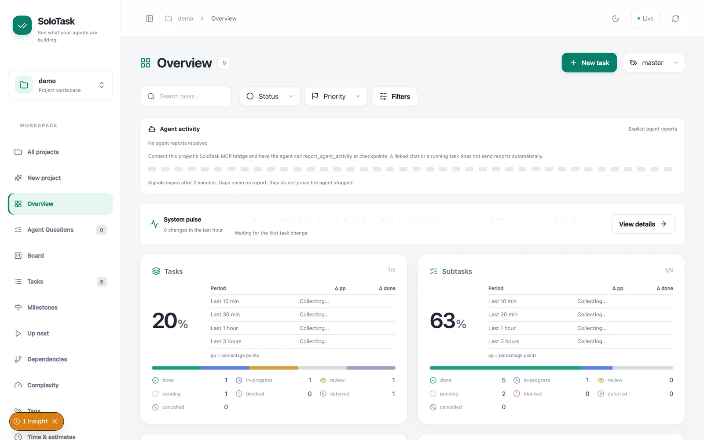
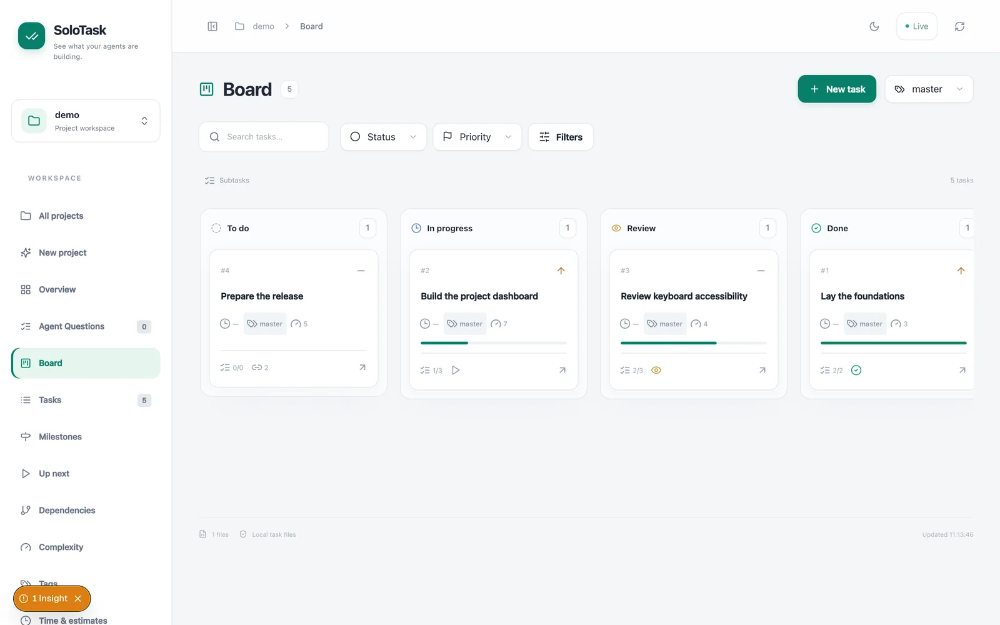
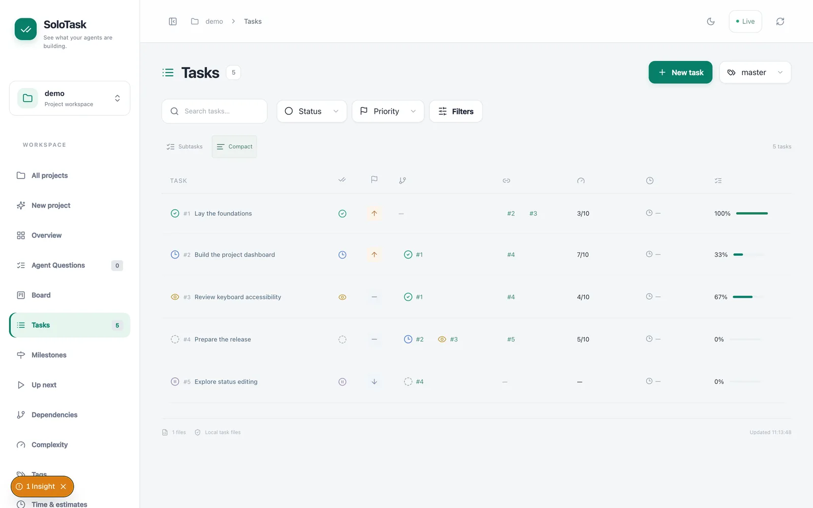
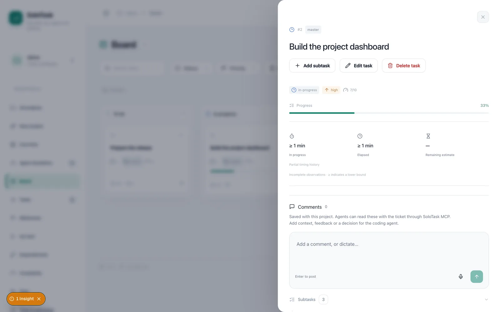
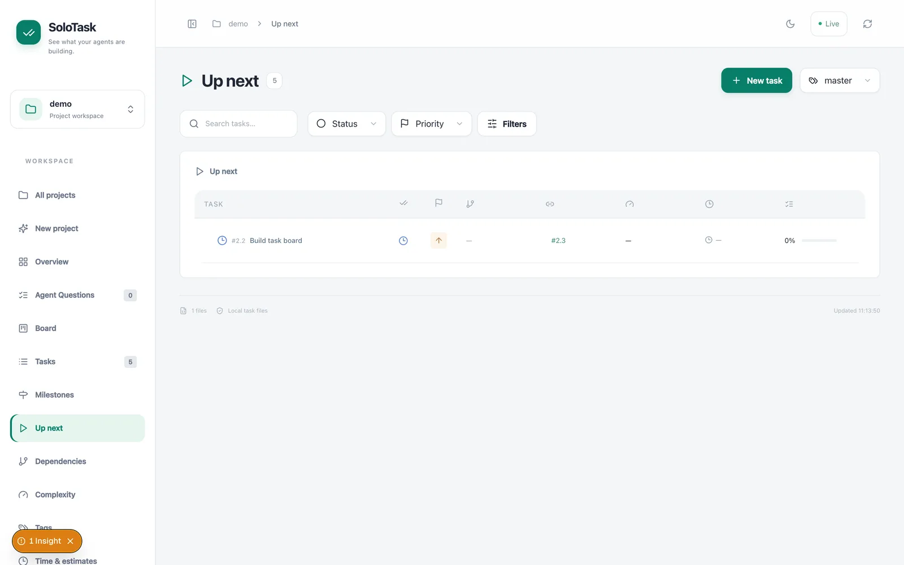
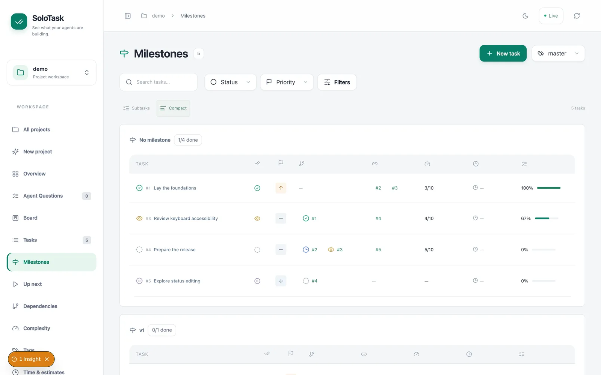
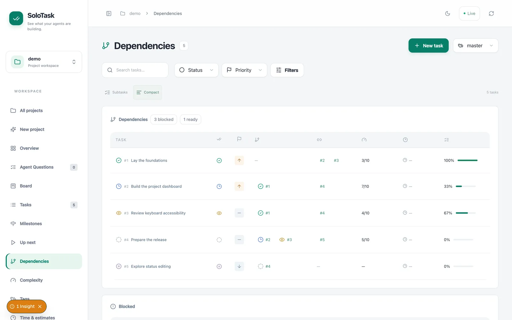

# SoloTask

**See what your AI agents are building.**

SoloTask is a live board for projects you build with Claude Code and [Task Master](https://github.com/eyaltoledano/claude-task-master). Task Master turns your plan into tasks. Claude works through them. SoloTask shows you, in real time, what is done, what is next and what is blocked. It runs only on your laptop and changes nothing in your project.

I built it because I wanted to watch my agents work instead of scrolling through a terminal. I use it every day.



> **Want to build like this?** I'm Aemal Sayer. I teach founders, executives and teams to build real products with AI agents, hands-on. I have trained more than 10,000 people in AI in person.
>
> - **[AI workshops](https://aemalsayer.com/workshops)**: build your AI-native company in one weekend, in Berlin or online.
> - **[Free live masterclasses](https://aemalsayer.com/events/upcoming)**: AI employees, agent harnesses, your first app with Claude Code.
> - **[Scholarships](https://aemalsayer.com/scholarships)**: can't afford a seat? Apply.
> - Say hi on **[LinkedIn](https://linkedin.com/in/aemal)**. If SoloTask helps you, a star on this repo helps me.

## What it looks like

| | |
|---|---|
|  **Board.** To do, In progress, Review, Done. Refreshes every three seconds while Claude works. |  **Tasks.** Status, priority, dependencies, complexity and progress in one list. |
|  **One task.** Details, timing, subtasks and comments your agent can read. |  **Up next.** Always know where Claude should continue. |
|  **Milestones.** Progress per milestone. |  **Dependencies.** What waits for what, and what is ready. |

## Install once

Requires Node.js 22.12+ and Git.

```bash
git clone https://github.com/aemal/solotask.git /tmp/solotask-install && bash /tmp/solotask-install/install.sh
```

The installer keeps one checkout at `~/.local/share/solotask` and links the `solotask` command in `~/.local/bin` (the old `vibeboard` command works too). Add `export PATH="$HOME/.local/bin:$PATH"` to your shell configuration if that directory is not already on your PATH. Re-run `bash ~/.local/share/solotask/install.sh` to update.

Not into terminals? Open the Claude desktop app, go to the Code tab, choose any folder and say: *"Install SoloTask from https://github.com/aemal/solotask for me and explain each step."*

## Use in any project

```bash
cd /path/to/your/project
solotask
```

Or `solotask /path/to/project --port 4311`. Open the printed localhost URL. Use different ports for simultaneous projects. Ctrl+C stops the server.

The UI installation stays outside host projects. No host `.gitignore`, package.json, git submodule, or generated file changes are needed. Host task data is never committed to the UI repository. The server binds to `127.0.0.1`. Existing project views remain read-only. The explicitly approved New project workflow creates planning files in a new or empty folder. All mutation endpoints require a same-origin request.

## What you see

- Dashboard, kanban, full/compact task list, milestones, next task, progress/blockers, complexity, tags and raw JSON views. Status, current/all tags, priority, milestone, source file, search and dependency filters can be combined. Blocked, cancelled, deferred and custom statuses retain their labels in the On hold column/drawer.
- Completion, priority, dependencies and complexity. Dependency links show whether prerequisites are complete or missing.
- Accessible side drawer with descriptions, details, test strategy and recursively nested subtasks.
- Full raw JSON for every task and subtask, including metadata, timestamps and custom fields.
- Automatic refresh every three seconds with parse warnings and last successful data retained on a refresh failure.

Reads all JSON recursively under `.taskmaster/tasks/`, plus `tasks/tasks.json` and root `tasks.json`. Supports `{tasks: [...]}`, task arrays, individual task objects and tagged `{master: {tasks: [...]}, feature: {tasks: [...]}}` data. Source and tag scope IDs independently; files are displayed as separate sources, so copies are not silently discarded. Symlinks inside task directories are skipped.

Complexity comes from task `complexity` or `complexityScore`, with fallback to `.taskmaster/reports/task-complexity-report.json` or `scripts/task-complexity-report.json` (`complexityAnalysis` entries, optionally nested by tag). Missing scores display “Not analyzed yet”. Full matched report fields appear in the drawer. Untagged reports apply by task ID; tagged reports match by tag and ID.

Task completion follows Task Master 0.43.1: done, completed and cancelled count as complete. The dashboard shows separate task and direct-subtask completion bars, every status count, priorities, dependency metrics, next task, milestone progress and complexity coverage. Deeper nested subtasks remain visible and are counted separately. Per-task progress recursively averages subtask completion; in-progress percentages are never invented.

## Development

```bash
npm install
npm test
npm run check
npm run build
node bin/vibeboard.mjs /path/to/project --dev
```

The CLI captures the host project path before starting Next.js in the UI checkout. `TASK_MASTER_PROJECT` is the server-side root; the launch folder is registered automatically. Additional project folders can be explicitly registered through the local project switcher; task reads accept registered project IDs only. To preview an empty board, launch against a directory without Task Master tasks.

## Project boundary

SoloTask is an independent integration, not a renamed fork of Task Master. Existing task views do not edit task status or project files. The New project workspace optionally sends PRD text to OpenAI and runs the separately installed Task Master CLI to create a new plan. There is no analytics or cloud project sync. Task JSON and PRD content render as plain text, not executable HTML.

To explore the included sample project: `node bin/vibeboard.mjs examples/demo`. Sample data is used only when you explicitly select that directory.

## Viewing command equivalents

| Task Master viewing command    | UI                                                                                     |
| ------------------------------ | -------------------------------------------------------------------------------------- |
| `list`, `list --with-subtasks` | Task List / Include subtasks, with task drawers in every view                          |
| `list --status pending`        | Status filter or Pending + subtasks preset                                             |
| `list --ready`                 | Ready / unblocked dependency filter                                                    |
| `list --blocking`              | Blocking others filter; reverse dependency links in task rows/drawers                  |
| `list --all-tags`              | All tags selector or Tags view                                                         |
| `list --watch`                 | Live sync button, enabled by default, refreshes every 3 seconds                        |
| `list --json`                  | Filtered JSON view with source and tag provenance                                      |
| `list --compact`               | Compact list option                                                                    |
| `show <id>`                    | Click any task or dependency to open its drawer                                        |
| `next`                         | Next Task and dashboard recommendation                                                 |
| `complexity-report`            | Complexity view and matched raw reports in drawers                                     |
| `validate-dependencies`        | Progress & Blockers dependency validation                                              |
| Group by milestone             | Milestones view; metadata, structured fields or explicit `Milestone:` lines in details |

Current tag is read from `.taskmaster/state.json` when present. If unavailable, the first discovered tag is selected. Tag selection only affects the viewer; it does not change Task Master state. The next suggestion prefers ready subtasks of an in-progress parent, then ranks by priority, dependency count and numeric task ID. Prerequisites are resolved against the complete project even when filters hide completed tasks. Bare subtask dependency IDs address siblings; dotted IDs address explicit task/subtask paths. Source files and tags scope dependency references.

Milestone labels are not guessed from task numbers or titles. If no supported milestone field or explicit detail line exists, the task belongs to “No milestone”. Complexity values remain unknown until present in task data or a saved report.

All displayed project facts come from the selected root at request time. The included demo is independent synthetic data and is never substituted for real project data. Viewing requires no Task Master CLI installation or provider access. The New project workspace can create a task plan in an approved new or empty destination. Editing existing task plans, application implementation/autopilot and dependency repair remain external operations.

## Interface and activity

The light theme uses compact, icon-led rows, collapsible task sections and custom Radix/shadcn Select controls. Every view lives in the sidebar; its collapse toggle keeps an icon rail with labeled tooltips. The sidebar preference is remembered in this browser. On narrow screens the rail is automatic.

Activity records observed task/subtask additions, removals, edits and status transitions. It starts with a baseline on the first successful scan; existing tasks are not misrepresented as newly added. It compares against the last snapshot after a restart, preserves the newest 1,000 events per project and pauses recording while task files have parse errors. Pausing live refresh also pauses observation until another refresh.

History is stored under the UI installation's ignored `.task-master-ui/activity/` directory, keyed by the absolute project path. Set `TASK_MASTER_UI_STATE_DIR` to choose another local state directory. These snapshots contain task data and stay outside the host project and Git commits.

Event timestamps are observation times, not verified edit times. Multiple edits between polls can be combined. The log is an activity aid, not a complete audit trail. Author names are only reported from explicit task/metadata fields such as `createdBy`, `generatedBy`, `updatedBy` and `modifiedBy`; otherwise attribution is “Unknown”. Existing `createdBy` values are not used to attribute later edits. The viewer never assumes that an unknown change came from an agentic harness. A harness must record author metadata for more precise attribution.

Development and production builds use Webpack, including `--dev`. This supports linked local dependencies while retaining automatic React Fast Refresh.

Activity compares cached task objects rather than file modification times, ignores timestamp-only edits (including metadata timestamps), and orders events newest-first. Valid task-recorded `createdAt` / changed `updatedAt` fields supply the displayed time; detection time is retained separately and available on hover. Missing, unchanged, invalid or future source timestamps fall back to detection time. Older cached events retain their original detection timestamps; their exact edit times are not reconstructed.

## Time and estimates

The **Time & estimates** view, task drawers and overview show observed in-progress time, elapsed duration and estimated remaining effort. Timing state is persisted per project in the existing local cache, independently of the 1,000-event activity limit. Keep Live refresh enabled while work runs; it observes status transitions, not actual keyboard/CPU activity.

A transition into `in-progress` starts or resumes tracking; other statuses pause in-progress time. Elapsed time includes pauses. Completion stops the timer. Reopened work starts a new cycle. Missed starts and observation gaps longer than 60 seconds make a record partial; uncertain intervals are not added to tracked time. Partial observations display a lower bound and are excluded from calibration. Cancelled work is never a calibration sample.

Explicit, valid `startedAt` and `completedAt`/`finishedAt` fields can supply historical elapsed durations. Creation/modification timestamps do not. Historical elapsed durations do not prove active time and therefore do not calibrate the in-progress model.

Estimates require at least three fully observed, completed tasks with positive complexity scores. They use median in-progress time per complexity point; a historical 10th-90th percentile range is shown. Scores are captured at work start (or when first supplied). Parent tasks and subtasks have separate calibration pools. Unknown-complexity tasks, partial active records and insufficient history show no estimate; overruns are labeled rather than shown as a zero-minute countdown.

Project remaining effort sums top-level estimated tasks, excludes children to avoid double counting, and displays estimate coverage. It is a serial effort total, not a promised delivery date or a prediction of parallel execution, queues or future waiting. Durations and estimates are project-local and never written into the host Task Master JSON.

The `solotask` command is the primary launcher. `task-master-ui` remains a compatibility alias. Existing install folders, local caches, environment variables and browser preferences remain supported so renaming does not lose history or disrupt running projects.


## Multi-project cockpit

Click the project name at the top of the sidebar (or the folder icon when collapsed) to search and switch projects. Choose **Add existing folder** and paste the absolute path to a local folder. The browser connects to the SoloTask server’s filesystem, so the path must exist on that computer. Empty folders are supported and show an empty task view.

**All projects** shows progress, active/review/blocked task counts and the latest observed change for every registered folder. Pin projects to keep them at the top. Recently opened projects sort ahead of other unpinned projects in the switcher; the last selected project is remembered in this browser. Click the latest activity task in a project card or the Overview pulse to open its task drawer. Removed tasks remain in history but cannot be opened.

The registry persists in `.task-master-ui/projects.json` under the UI installation (or `TASK_MASTER_UI_STATE_DIR`). Activity and timing remain isolated by canonical project folder. With Live enabled, the selected project refreshes every 3 seconds and the cockpit scans all registered projects every 10 seconds, including inactive projects. Pausing Live stops both automatic scans. Project switches reset task filters and close the previous task drawer. A missing folder shows an error on its card while other projects stay available.


## Credits

Task generation uses [Task Master](https://github.com/eyaltoledano/claude-task-master) by Eyal Toledano and Ralph Khreish, installed separately as an external tool. Its license is MIT with the Commons Clause. Its notice is kept at `public/licenses/task-master.txt` and linked from the `/about` page. SoloTask is not endorsed by the Task Master authors.

## PRD workspace (web application)

Open **New project** in the sidebar, or **New project from PRD** in the switcher:

1. Import a `.md`, `.markdown` or `.txt` PRD (up to 100 KB), type an idea, dictate an idea locally, or write directly in the PRD editor. **Use my text as the PRD** skips AI drafting.
2. To draft with AI, enter your OpenAI API key and an accessible model ID. The default is `gpt-4o`; model access and billing belong to your account. SoloTask uses the Responses API with `store: false`. This setting is not a claim of zero provider retention.
3. Select text in the PRD editor, type or dictate revision instructions, and choose **Suggest revision**. Review the original and replacement, then apply or discard. Only that selection is replaced. Changing the document invalidates stale selections and suggestions. Undo restores previous AI/import replacements during the current page session.
4. Download `prd.md` whenever you want. The brief, document, destination and current run ID are also saved in browser local storage. API keys are held in memory only, never in local storage, logs or generated configuration. **Forget key** clears the UI key; an already running request keeps its own copy until completion.
5. Enter a **new or empty absolute destination folder**, choose the Task Master OpenAI model and task count (1-50), review the PRD, and approve the provider call. **Generate project tasks** runs `task-master parse-prd` in staging with the key passed through the child’s environment, without shell interpolation.
6. Follow the live log or cancel. After successful validation, `.taskmaster/docs/prd.md`, `.taskmaster/config.json` and `.taskmaster/tasks/tasks.json` are published and the folder is registered in the cockpit. Existing project files and task plans are refused. A failed/cancelled run leaves the destination without a task plan; newly created empty folders may remain. The key is not saved; later standalone Task Master operations need their own credentials.

Task generation creates a **plan**, not a completed application. It does not install an MCP connection into Codex or run a coding agent. These integrations remain separate follow-up work.

### Local tool setup

Use Node.js 22.12+ for the server and the Task Master CLI:

```bash
npm install -g task-master-ai
python3 -m pip install -U openai-whisper
# macOS; install ffmpeg with your platform package manager otherwise
brew install ffmpeg
```

Whisper and ffmpeg must be installed on the **computer running SoloTask**, which is also where audio is transcribed and project folders are created. In this local web deployment that is your own computer. Dictation uses browser microphone access on localhost/HTTPS, streams short PCM16 windows to a persistent local Whisper worker. There is no fixed recording-duration cap. Live dictation keeps audio windows in memory instead of writing them to disk. The legacy whole-recording endpoint still removes temporary files after each request. Audio is not sent to OpenAI’s transcription API. The first run may download the selected Whisper model and tokenizer assets; ensure it is available before a workshop. AI drafting sends the resulting text, not the audio, to OpenAI.

Optional server environment variables:

| Variable | Purpose |
| --- | --- |
| `VIBEBOARD_TASK_MASTER_BIN` | Absolute Task Master CLI executable path |
| `VIBEBOARD_WHISPER_BIN` | Absolute OpenAI Whisper CLI executable path |
| `VIBEBOARD_FFMPEG_BIN` | Absolute ffmpeg executable path |
| `VIBEBOARD_WHISPER_MODEL` | Local Whisper model; defaults to `base` |

The capability indicators check executable availability, not successful inference or API access. Task Master CLI flags were inspected against locally installed version 0.17.0; live provider calls require a valid user-supplied key. Automated tests use controlled provider/process substitutes and never consume a real API key.

Runs execute in the long-lived local Node.js server. Their status and bounded logs are kept in server memory and reconnect after browser reload using the saved run ID; server restarts lose that status. Do not shut down the server during a run. If the server was interrupted, inspect the destination before retrying. This is a localhost app, not an authenticated multi-user or serverless deployment.


### Continuous local dictation

**Dictate live** opens a live transcript beneath the idea or revision input. While you speak, the current passage is refreshed roughly every 3 seconds of captured audio; actual delay depends on model startup and inference speed. Pauses finalize passages, with a maximum window of 15 seconds and a short overlap at forced boundaries. The latest passage can change as context arrives. Basic energy and Whisper confidence checks suppress silence; they are not a guarantee of accurate transcription.

Choose **Stop & review** to finish pending speech, edit the transcript, then **Use transcript** to append it to the idea or revision instructions. No PRD or selection is changed automatically. Leaving the New project view stops microphone capture. A maximum of four finalized pending windows stops capture with a visible message so a slower computer can drain the backlog; it does not silently discard queued passages. Failed windows remain in memory for **Retry remaining audio**. Discarding a recording clears its in-memory queue; refreshing the page loses unapplied transcript/audio.

The worker uses the Python interpreter in the installed Whisper executable’s shebang, or `VIBEBOARD_WHISPER_PYTHON` when provided. That interpreter must have `openai-whisper`, NumPy and PyTorch installed. `VIBEBOARD_WHISPER_THREADS` defaults to 4 (1-16). The model is reused between windows/sessions and released after ten idle minutes. Live PCM capture does not need ffmpeg; the legacy whole-recording endpoint does. Local processing still may require first-run model/tokenizer downloads; warm it before a workshop. No OpenAI API key is needed for dictation.

The live endpoint is same-origin, limits each request to 20 seconds of 16 kHz mono PCM16, and bounds server pending work. Automated tests cover audio resampling/tail flush, overlap merging, request validation and worker reuse with a controlled subprocess. Live microphone accuracy and latency must be measured on the target machine; the earlier installed Whisper’s tokenizer download could not be completed in the restricted execution environment.


### Single-page PRD editing

The PRD workspace opens a single document canvas instead of a side-by-side editor. Click directly into the document to edit headings, paragraphs, lists, quotes, bold/italic text and fenced code. The compact toolbar supports heading/list blocks and inline formatting. Markdown headings or list prefixes typed into a paragraph become formatted blocks when you press Enter. Plain-text paste avoids importing executable HTML.

**Draft from an idea** and **AI settings** are collapsible sections above the document. Select visible text to open **Refine selected text**; selection offsets are mapped back to the Markdown used by the revision API. Voice input and approve/apply revision behavior remain available. **Markdown** switches the same surface to source editing for advanced syntax; it is not a second column. Tables, links and other unsupported rich blocks remain editable Markdown text.

Edits auto-save the browser draft as you type. **Download** exports the current `prd.md`; importing a file does not grant the browser ongoing write access to the original file on disk. Task generation writes the approved version into the new project's `.taskmaster/docs/prd.md` as before.

### Phone access through ngrok

Keep SoloTask running on your computer and tunnel port 4310 (`ngrok http 4310`). Set the exact public HTTPS origin in the SoloTask installation's `.env.local`, then restart SoloTask:

```dotenv
VIBEBOARD_PUBLIC_ORIGIN=https://your-domain.ngrok-free.dev
```

This allows that domain for development assets and write requests through the proxy. Update it when your tunnel URL changes. Forwarded headers and other ngrok domains are not trusted automatically. Open the HTTPS URL directly in Safari or Chrome on your phone and allow microphone access. Whisper still runs on the computer; phone audio travels through ngrok to that computer. Keep the computer awake. Browser drafts and API key entry are separate on each device/origin. The tunnel exposes the local app, so restrict tunnel access to intended users.

## Developing SoloTask with Task Master

You can plan work on SoloTask itself with Task Master: keep a PRD in `.taskmaster/docs/prd.md` and let Task Master turn it into `.taskmaster/tasks/tasks.json`.

Use Node 22.12 or newer for Task Master, and run commands from this repository:

```sh
task-master list --with-subtasks
task-master next
task-master add-task --prompt="Describe the next feature" --priority=medium
task-master set-status --id=16 --status=in-progress
```

AI task creation requires your provider credentials in your local environment; never commit them. Existing task views remain read-only: UI task creation and editing are backlog items 16-19. Do not run `parse-prd --force` over this curated backlog, as that can replace IDs and completion statuses. Add this repository's absolute folder path with **Add existing folder** to see it in the cockpit. Keep the PRD and tasks in git as the scope evolves.

## Agent Smartness and Agent Questions

**New project** includes a collapsible **Agent Smartness template · AGENTS.md** editor. Customize it before generation; it auto-saves with the browser draft. Successful generation places the instructions in `AGENTS.md` at the destination project root alongside `.taskmaster`. Existing files are never overwritten during new-project generation. Open **Project settings → Project documents** to edit `AGENTS.md` alongside root Markdown files such as `README.md` and planning documents under `.taskmaster/docs`, including `prd.md`. Each document has its own collapsible editor and saves to its existing project location. Disk changes detected since loading are rejected; reload intentionally before editing the newer version.

**Agent Questions** is an owner decision inbox with an unanswered-count badge, typed or dictated responses, an inbox-zero state, and separate answered/awaiting-agent and resolved views. Questions belong to the selected project. The current local app has no per-user identity system: remote access control is still a separate backlog item, so do not treat this owner designation as authentication.

The default instructions queue routine questions while independent work continues, reserve configured Twilio/ElevenLabs MCP calls for important blockers, and require agents to consume batches of answers and acknowledge application. Calls and automatic ChatGPT resumption require an actual configured bridge; the current question store alone does neither. See [the integration contract](docs/agent-question-bridge.md) and tasks 33-39 for remaining bridge work.

Project document editors and new-project agent templates support selecting a passage and requesting an AI revision. Provide revision instructions and an OpenAI key, review the replacement, then apply or discard it. Applying changes the editor draft; **Save file** writes an existing project's file. Suggestions never save to disk automatically. Mobile text selections are tracked through browser selection-change events.

## Simple document workspace and performance

Project settings opens a document explorer with file tabs for owner-facing Markdown. New projects use the same editor for `prd.md` and `AGENTS.md` before generating tasks. Tabs retain unsaved editor text while switching; **Save file** persists existing-project edits. All editors support selected-passage AI review and typed/dictated revision instructions. Questions show pending items first, answered items below, then resolved history. Visible dropdowns must use shared shadcn/Radix components; this rule lives in `AGENTS.md` and the project template.

Task polling pauses in document, creation and question views; hidden browser tabs skip automatic polling. Task requests cannot overlap. Background responses bound activity history and omit the server timing store; Overview and Activity request full history. The project cockpit scans frequently only while displayed. Editor code loads on demand and draft storage is debounced. For phone/ngrok use, build once and launch production mode (`npm run build`, then `npm start`); `--dev` serves much larger development assets. These changes reduce repeated work; they do not constitute a measured phone latency guarantee.

## Owner-question MCP bridge (checkpoint pull)

`bin/vibeboard-mcp.mjs` is a local stdio MCP server exposing `ask_owner`, `read_owner_questions`, `read_owner_answers`, and `acknowledge_owner_answer`. Configure it in a client that supports local stdio MCP, with Node 22.12+ on PATH:

```json
{
  "mcpServers": {
    "vibeboard": {
      "command": "node",
      "args": ["/absolute/path/to/vibeboard/bin/vibeboard-mcp.mjs"],
      "env": {
        "VIBEBOARD_SERVER_URL": "http://localhost:4310",
        "VIBEBOARD_PROJECT_ID": "the-registered-project-id"
      }
    }
  }
}
```

Project IDs come from `/api/projects`; the bridge refuses to guess one and restricts its HTTP connection to localhost. SoloTask must be running. A connected agent calls `read_owner_answers` at each checkpoint, receiving all answered/unconsumed decisions together into that invoking session's tool context. Only after applying a decision should it acknowledge the exact answer; this moves the question to resolved history. Question creation validates linked Task Master IDs and deduplicates repeated IDs/text. Writers use a shared exclusive lock and check for external edits; legacy writers that ignore the lock must migrate to the bridge.

This does **not** automatically install an MCP connection into an existing ChatGPT conversation, schedule a run, send a message to another chat, or place a phone call. A ChatGPT deployment that accepts only remote MCP needs a separately hosted/authenticated remote adapter; the local stdio command cannot be pasted as a remote endpoint. Until that delivery adapter is configured, use **Copy all answers for this project's chat** and paste the batch into the intended conversation, or let a connected agent consume it at its next checkpoint. Copying does not mark answers resolved.

The default `AGENTS.md` template includes the owner's five-minute scheduled continuation request. A real scheduling tool must create and verify that schedule in the originating chat. Template text alone does not activate a schedule, and agents must report unavailable scheduling instead of claiming continuous execution.

## Adopt an existing project

Use **Add existing folder** in the project switcher. A project without tasks shows **Set up Task Master & generate tasks**. This opens the PRD workspace with that folder selected. An existing root `prd.md`/`PRD.md` is loaded when present; otherwise import, type or draft the PRD, then review it. **Use an existing project folder** also lets you choose this mode directly from New project. Initial generation adds `.taskmaster` planning files, preserves existing source files and `AGENTS.md`, and automatically opens the generated project when the active run completes. Existing Task Master or legacy task plans are rejected rather than overwritten. This does not infer a completed-task history from source code automatically.

The project form has **Back to projects**. The document explorer uses its own scoped layout and theme colors so it cannot cover the application sidebar.

All projects now shows a compact system pulse on each available project card: forty bins across the last hour, recent-change/quiet/interrupted observation status, and **View activity** opening that project's Activity view. The server sends aggregate bins, not all activity events, to the cockpit. Pulses show observed task changes rather than proving that a coding agent is healthy or still running.

Owner answers use a theme-aware composer with an inline microphone and send arrow. Type multiline text or dictate, review and use the transcript, then send the answer. Enter sends; Shift+Enter inserts a new line. IME composition does not submit. Empty answers and unfinished dictation cannot be sent. Question cards have separate spacing; existing answer delivery semantics are unchanged.

## Inline dictation and local Whisper readiness

The answer microphone stays inside its composer. During capture it shows a waveform driven by microphone input, cancel on the left and finish on the right. Finish transcribes remaining queued audio and inserts text into the same answer box for review before sending; it does not submit the answer automatically. Failed audio remains available for retry until discarded. The service warms both model and tokenizer before opening the microphone so setup failures appear before speech starts.

If Python packages on the server PATH conflict, set `VIBEBOARD_WHISPER_BIN` and `VIBEBOARD_WHISPER_PYTHON` in the installation's local environment to the same tested Whisper environment. Readiness now reports setup failures explicitly. A compatibility shim avoids older Whisper versions' unnecessary GPT-2 vocabulary download when only its fixed tokenizer regex is needed; bundled token ranks remain unchanged. Synthetic audio and warmup checks do not replace a real microphone/device acceptance check.

## Disk storage and backup retention

Next.js generated build output is in `.next/` inside the SoloTask installation; Webpack caches are under `.next/cache/webpack` (production) and `.next/dev/cache/webpack` (development). Stop the server before removing `.next/`; a production server then needs `npm run build` again. Never prune active compiled chunks while the server is running.

SoloTask state lives in `.task-master-ui/` (or `TASK_MASTER_UI_STATE_DIR`). Task recovery copies live separately in each edited project at `.vibeboard/task-backups/`. After each successful task mutation, retention runs under the task source edit lock: at most 50 generated backups, up to 25 MiB, and no older than 30 days per task source. Always keep the just-created recovery copy, even if it alone exceeds the size limit. Cleanup only recognizes generated backup filenames for that source; manual backups, other sources, symlinks and `.vibeboard/backups/` remain untouched. Cleanup failures do not undo a committed edit; the API returns `backupWarning`. Existing backups are pruned on that source’s next successful edit; there is no background deletion job.

---

Made by [Aemal Sayer](https://aemalsayer.com). I run hands-on [AI workshops](https://aemalsayer.com/workshops) and [free masterclasses](https://aemalsayer.com/events/upcoming) for founders, executives and teams. Come build with me.
